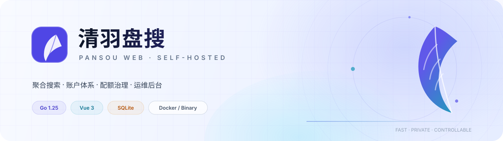
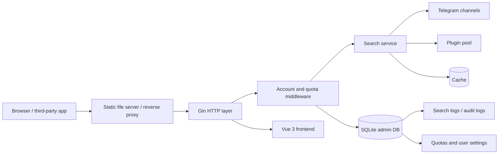

<div align="center">

<picture>
  <source media="(prefers-color-scheme: dark)" srcset="docs/assets/banner-dark.svg">
  <source media="(prefers-color-scheme: light)" srcset="docs/assets/banner-light.svg">
  
</picture>

<h1>Qingyu PanSou</h1>

[简体中文](README.md) · **English**

### A cloud-drive search site you can actually operate

Search aggregation, accounts, quota governance, IP geolocation, audit logs, upstream sync,
and multi-platform releases — all in one repository. Deploy with one Docker command,
or download a self-contained binary and run it directly.

[](https://github.com/liushen-fork/pansou-web/releases)
[](backend/go.mod)
[](frontend/package.json)
[](backend/admin/db.go)
[](https://github.com/liushen-fork/pansou-web/pkgs/container/pansou-web)
[](#releases-and-standalone-binaries)

</div>

---

## Table of Contents

- [Why Qingyu PanSou](#why-qingyu-pansou)
- [Feature Overview](#feature-overview)
- [Architecture](#architecture)
- [Quick Start](#quick-start)
- [Default Administrator](#default-administrator)
- [Admin Console](#admin-console)
- [User Center](#user-center)
- [Quota System](#quota-system)
- [API Integration](#api-integration)
- [Audit Logs and Search Tasks](#audit-logs-and-search-tasks)
- [IP Geolocation (GeoIP)](#ip-geolocation-geoip)
- [Releases and Standalone Binaries](#releases-and-standalone-binaries)
- [Upstream Auto-Sync](#upstream-auto-sync)
- [Configuration](#configuration)
- [Data, Backup, and Upgrade](#data-backup-and-upgrade)
- [Local Development and Testing](#local-development-and-testing)
- [Project Layout](#project-layout)
- [FAQ](#faq)
- [Security Notes](#security-notes)
- [Acknowledgements](#acknowledgements)

## Why Qingyu PanSou

PanSou already solves aggregation: Telegram channels, plugins, cloud-drive links,
caching, and concurrency. But opening search to a group of people needs more than search.
You need to know who is using it, how much they may use, what happens when they exceed
their quota, where to investigate failures, and whether upgrades will lose data.

Qingyu PanSou fills that gap:

- **Unified accounts**: username/email passwords, email-code registration, OAuth2 login and binding.
- **Layered quotas**: anonymous per-IP limits; separate web and API limits for signed-in users,
  each with a daily cap and a per-minute rate.
- **Operable**: per-user overrides, quota-trigger audit events, search-task logs, IP geolocation, CSV export.
- **Deployable**: multi-arch Docker images, standalone binaries, one-click GitHub Releases.
- **Maintainable**: upstream channel/plugin defaults sync automatically, runtime settings live in
  the admin console, and upgrades need only one data directory.

This is not a thin wrapper around PanSou. It turns search capability into a service that can be
operated for the long term.

## Feature Overview

| Area | Capabilities |
| --- | --- |
| Aggregated search | Parallel Telegram channel + plugin search, merged results, cloud-drive grouping, link validation |
| Search UX | Keyword search, source filters, cloud-type filters, cache refresh, categorized results |
| Accounts | Username/email login, email-code registration, password change, profile editing, sessions |
| Social login | GitHub / Google / Linux DO / generic OIDC; login, auto-registration, account binding |
| Personal API | Up to 10 `ps_` tokens; plaintext shown once; tokens share account quota and can be revoked |
| Anonymous protection | Same-origin web token + per-IP rate limit + per-IP daily cap + global anonymous daily cap |
| Signed-in quotas | Web and API counted separately; daily cap + per-minute rate; per-user overrides |
| Limit UX | Anonymous users are invited to sign in; signed-in users are told to contact the admin |
| Admin console | Overview, users, logs/audit, auth/site, OAuth, upstream sync, runtime settings, system status |
| Observability | Per-search keyword, source, IP, UA, geolocation, result count, duration, status, error |
| GeoIP | ip2region xdb; IPv4 required / IPv6 optional; private IPs skipped; hot reload on save |
| Site customization | Site name, slogan, description, icon, Markdown announcement, light/dark theme |
| Distribution | Docker amd64/arm64, Linux/macOS/Windows binaries, GitHub Release, GHCR |
| Upstream upkeep | Build-time and runtime sync of upstream channels/plugins; hot reload and fallback |

## Architecture



**Request path**

1. A browser opens the app; a static file server or Go's embedded file system (standalone
   binary) serves the Vue build.
2. Anonymous web search first exchanges `/api/web/token` for a short-lived token bound to
   the client IP and User-Agent.
3. The search request enters Gin. `AttachUser` identifies a session or API token, and
   `AccessGate` checks, in order: login requirement → web-search switch → same-origin token →
   per-minute rate → daily quota.
4. On success a `pending` search log is written, then the search service queries Telegram
   and plugins concurrently.
5. When the response is ready, keyword, result count, duration, and status are filled in.
   Quota failures return `429` with structured details and UI hints.
6. The admin console reads statistics, logs, quotas, and audit data from the same SQLite DB.

## Quick Start

### Option 1: Docker Compose (recommended)

```bash
curl -O https://raw.githubusercontent.com/liushen-fork/pansou-web/main/docker-compose.yml
docker compose up -d
```

Open `http://localhost`. Data lives in the `pansou-data` volume at `/app/data`.

### Option 2: Run the image directly

```bash
docker pull ghcr.io/liushen-fork/pansou-web:latest
docker run -d --name pansou \
  -p 80:80 \
  -v pansou-data:/app/data \
  --restart unless-stopped \
  ghcr.io/liushen-fork/pansou-web:latest
```

Images are published for `linux/amd64` and `linux/arm64`. All persistent data (account DB,
cache, logs, SSL, GeoIP) is under `/app/data`, so image upgrades do not lose state.

### Option 3: Download a standalone binary

Download the archive for your platform from
[Releases](https://github.com/liushen-fork/pansou-web/releases):

```bash
tar -xzf pansou-web_v1.0.0_linux_amd64.tar.gz
cd pansou-web_v1.0.0_linux_amd64
./pansou
```

On Windows, unzip and run `pansou.exe`. The server listens on `http://localhost:8888` by
default. The frontend is embedded in the binary, so no Node.js, extra static server, or frontend
files are needed. The bundled `upstream-defaults.env` is loaded automatically.

### Option 4: Run from source

Requires Node.js 22+ and Go 1.25.

```bash
npm --prefix frontend ci

# Terminal 1: backend on :8888
npm run dev:backend

# Terminal 2: frontend on :3000, proxies /api
npm run dev
```

Open <http://localhost:3000>.

## Default Administrator

The first startup creates exactly one administrator:

| Username | Password |
| --- | --- |
| `admin` | `admin123456` |

You must change this password after signing in. Until then, only the user center and
password-change endpoints are available. The administrator is unique at the database level;
the API cannot create a second admin, promote a user, or delete the admin.

> [!WARNING]
> Change the default password before exposing the service to the internet and put it behind
> HTTPS. The default is public; leaving it unchanged hands the admin console to anyone.

**Forgot the password?** Start the backend/container once with `PANSOU_RESET_ADMIN=1` to reset
the admin to the default password and force a change. Alternatively, delete `pansou-admin.db`
from the data volume to reinitialize (this clears all account data).

## Admin Console

Sign in and click **Console** in the top-right corner. Navigation follows daily operations:

| Page | Purpose |
| --- | --- |
| Overview | Users, today's searches, anonymous searches, quota triggers, web/API split, top countries, noisy anonymous IPs, recent audit |
| Users | Create/disable/delete users, reset passwords, set role and four quota fields (web/API daily and per-minute) |
| Logs & Audit | Two tabs for search tasks and audit events; filter by keyword/user/IP/source/status/event; CSV export |
| Auth & Site | Login/registration switches, SMTP, API permissions, anonymous/user quotas, GeoIP, site name/icon/announcement |
| OAuth2 Login | Configure the single enabled third-party login provider and auto-registration |
| Upstream Sync | Sync upstream Telegram channels and plugins; inspect last success/failure, revision, restart hint |
| Runtime | Proxy, cache, concurrency, outbound concurrency, web-token signing secret |
| System Status | Plugins, channels, Telegram reachability, plugin/channel liveness observations |

### Authentication policy

| Feature | Behavior |
| --- | --- |
| Username/email password login | Admin can always use password login, avoiding lockout if other methods are disabled |
| Email registration | Requires SMTP verification; the switch cannot be saved without SMTP configured |
| OAuth2 login | Users with a bound third-party account can sign in |
| OAuth2 registration | First OAuth login creates a local account automatically |
| Personal API tokens | Up to 10 per user; plaintext shown once; revoked immediately on delete |
| Login throttling | 5 failures per IP or account within 15 minutes temporarily locks further attempts |
| Sessions | 7 days by default, adjustable in admin; logout invalidates the session, password change revokes other sessions |
| CSRF | Cookie-based writes validate `Origin`; Bearer/API-token requests are exempt |

The OAuth2 callback URL is always:

```text
https://your-domain/api/auth/oauth/callback
```

Register that URL with the provider, then fill in the Client ID / Client Secret. The app derives
the callback scheme and host from the browser-visible page address, `Origin` / `Referer`, and
standard forwarding headers, so no extra reverse-proxy configuration is required. GitHub,
Google, Linux DO, and generic OIDC presets are built in.

## User Center

Signed-in users can:

- See today's web-search and API usage, limits, per-minute rates, and reset time;
- Review the 20 most recent search tasks (keyword, source, result count, duration, status);
- Change username, email, and password;
- Manage personal API tokens (create, name, revoke; up to 10);
- Bind or unbind third-party accounts.

Quota cards clearly say whether a value follows the site default or was assigned by the admin,
so users do not mistake a default for a missing quota.

## Quota System

Quotas are split by **identity + entry point**, and never mixed:

| Identity | Entry point | Daily cap | Per-minute rate | Notes |
| --- | --- | --- | --- | --- |
| Anonymous | `/api/web/search` | **20** per IP | **4** per IP | Plus a global anonymous cap of **200**/day |
| Signed-in | `/api/web/search` | **100** | **10** | Web searches, counted against the web quota |
| Signed-in | `/api/search` | **100** | **10** | External apps/scripts, counted against the API quota |

These are defaults, editable under **Admin → Auth & Site**. For any individual user, the admin
can override:

- Web daily cap and web per-minute rate;
- API daily cap and API per-minute rate;
- `0` means “follow the site default”; it never locks the user out.

### Counting rules

- **Web search**: searches started from the browser, always through `/api/web/search`.
- **API call**: external apps using a personal token against `/api/search`.
- The two entry points are counted separately; refreshing the page or changing filters does not reset usage.
- Daily quotas reset at **00:00 server local time** (the Docker image defaults to `Asia/Shanghai`).
- Only real searches consume quota; plugin web pages and link checks do not.
- Anonymous checks run in order: per-minute rate, per-IP daily cap, global daily cap.

### Quota-exceeded response

All quota failures return `429` with structured fields used by the frontend modal:

```json
{
  "error": "This IP has reached its daily anonymous search limit (20). Sign in for a higher quota.",
  "code": "ANON_IP_DAILY_LIMIT",
  "scope": "anonymous_ip_daily",
  "limit": 20,
  "used": 20,
  "retry_after": 0,
  "login_recommended": true,
  "contact_admin": false
}
```

| `code` | Meaning | UI hint |
| --- | --- | --- |
| `ANON_RATE_LIMITED` | Anonymous per-minute rate exceeded | Wait or sign in |
| `ANON_IP_DAILY_LIMIT` | Per-IP anonymous daily cap reached | Sign in for a higher quota |
| `ANON_GLOBAL_DAILY_LIMIT` | Global anonymous daily cap reached | Sign in to continue |
| `WEB_RATE_LIMITED` | Signed-in web rate exceeded | Wait and retry |
| `WEB_DAILY_LIMIT_REACHED` | Signed-in web daily cap reached | Contact the admin |
| `API_RATE_LIMITED` | API rate exceeded | Slow down requests |
| `API_DAILY_LIMIT_REACHED` | API daily cap reached | Contact the admin |

Anonymous users see “Sign in / register for a higher quota”; signed-in users see
“Contact the administrator to raise your quota.” The modal shows current usage, the cap,
and the reset time. Every quota-trigger event is written to the audit log.

### Anti-bypass design

Anonymous web search is not a public API:

1. The page requests a short-lived token from `/api/web/token`;
2. The token is HMAC-signed and bound to the request IP and User-Agent;
3. Searches must send `X-Web-Token` from a same-origin request;
4. The backend also enforces the anonymous per-minute, per-IP daily, and global daily limits.

Copying `/api/web/search` into a script is therefore not a free API. Third-party apps should
use `/api/search` with a personal API token.

## API Integration

### Create a token

Sign in, open **User Center → API Tokens**, create a token, and copy the `ps_...` plaintext
(shown only once).

```bash
curl -H "Authorization: Bearer ps_xxxxxxxx" \
     "http://localhost/api/search?kw=example"
```

The `X-API-Token` header is also supported. All tokens share the account's API quota and stop
working immediately after deletion.

### Endpoints

| Method | Path | Purpose |
| --- | --- | --- |
| GET/POST | `/api/search` | External API search; consumes API quota |
| GET/POST | `/api/web/search` | Web search; consumes web quota; anonymous requires a web token |
| POST | `/api/check/links` | Link validation |
| GET | `/api/health` | Health, plugin/channel/Telegram status |
| GET | `/api/auth/me` | Current user, quota, and auth switches |
| GET | `/api/auth/usage` | Today's usage, limits, rates, recent searches |

### Search parameters

GET query parameters and POST JSON fields are the same:

| Parameter | Description |
| --- | --- |
| `kw` | Keyword (required) |
| `channels` | Telegram channels, comma-separated |
| `conc` | Concurrency |
| `refresh` | Refresh cache |
| `res` | `all` / `results` / `merge` |
| `src` | `all` / `tg` / `plugin` |
| `plugins` | Plugins, comma-separated |
| `cloud_types` | Cloud-drive types |
| `ext` | Extension JSON |
| `filter` | Result filter configuration |

Successful responses keep the upstream PanSou shape:

```json
{
  "code": 0,
  "message": "success",
  "data": {
    "total": 42,
    "results": [],
    "merged_by_type": {}
  }
}
```

### Status codes

| Status | Scenario |
| --- | --- |
| `401 UNAUTHORIZED` | Not signed in / invalid token / API login required |
| `403 WEB_SEARCH_DISABLED` | Anonymous web search disabled by the admin |
| `403 WEB_TOKEN_REQUIRED` | Anonymous web token missing, expired, or wrong origin |
| `403 MUST_CHANGE_PASSWORD` | Default admin password has not been changed |
| `429` + `code` | Per-minute rate or daily quota exceeded |

> `/api/search` requires login by default. The admin can disable **API requires login**, but
> this is not recommended on the public internet.

## Audit Logs and Search Tasks

**Admin → Logs & Audit** has two tabs. Both support filters, pagination, and CSV export.

### Search tasks

Every real search records:

- Time, user, source (web/API), keyword;
- IP, country, region, city;
- Result count, duration, status (`pending` / `ok` / `error` / `bad_request`);
- Error message (if any), User-Agent.

A search is written as `pending` when it starts and completed when it returns, making it easy
to investigate requests that entered the server but never produced a response.

### Audit events

Login, registration, quota triggers, and administrative actions:

`login_success`, `login_failed`, `login_throttled`, `logout`, `register`,
`password_change`, `profile_update`, `quota_exceeded`, `settings_update`,
`runtime_update`, `user_create`, `user_update`, `user_delete`, `upstream_sync`,
`api_token_create`, `api_token_delete`.

Each entry includes actor, target, detail, IP, geolocation, and User-Agent. Logs are retained
for **180 days** by default and older data is pruned at startup to keep SQLite healthy.

## IP Geolocation (GeoIP)

Geolocation is optional and off by default. When disabled, logs still record IPs, but country,
region, and city are empty.

### 1. Obtain the database

Use [ip2region](https://github.com/lionsoul2014/ip2region) xdb files:

- IPv4: `ip2region.xdb` (**required when enabled**; the official `ip2region_v4.xdb` works as-is)
- IPv6: `ip2region_v6.xdb` (optional, configured separately)

### 2. Mount it into the container

Edit `docker-compose.yml` and uncomment:

```yaml
volumes:
  - pansou-data:/app/data
  - ./geoip:/app/data/geoip:ro
```

Place the IPv4 file at `./geoip/ip2region.xdb` on the host. For IPv6, also add
`./geoip/ip2region_v6.xdb`, then run `docker compose up -d`.

### 3. Enable it in the admin console

Go to **Admin → Auth & Site → IP Geolocation**:

1. Enable **IP geolocation**;
2. Enter `/app/data/geoip/ip2region.xdb` as the IPv4 xdb path (**required when enabled**);
3. IPv6 is optional; leave it empty to skip IPv6 lookups;
4. Save.

The backend verifies that each file exists, has the correct xdb version, and passes integrity
checks before saving. On success it hot-reloads immediately, with no restart. Loopback, private,
and invalid IPs are skipped. For standalone binaries, use an absolute path on that machine.

## Releases and Standalone Binaries

`.github/workflows/build-docker.yml` builds images and release packages.

### Version in the workflow run title

When triggered manually, enter an `image_tag` (for example `v1.4.0`). The Actions run title
becomes:

```text
发布 v1.4.0
```

(`发布` means “Release”; the workflow intentionally uses a Chinese title.) That makes it
obvious which version is being published and what to publish next. When triggered by a GitHub
Release, the release tag is used automatically.

### `latest` toggle

Manual runs have `publish_latest` checked by default:

- Checked: push both `:v1.4.0` and `:latest`;
- Unchecked: push only `:v1.4.0`, suitable for prereleases or canary builds.

Publishing through a GitHub Release updates `latest` as well.

### Release assets and multi-platform binaries

The workflow:

1. Builds the frontend and embeds it into Go (`release_frontend` tag + `go:embed`);
2. Cross-compiles Linux amd64/arm64, macOS amd64/arm64, and Windows amd64;
3. Creates `tar.gz` / `zip` archives containing the executable, `upstream-defaults.env`,
   and `START_HERE.txt`;
4. Creates or updates the GitHub Release and uploads the archives;
5. Generates release notes from commit messages (`--generate-notes`).

Archive names:

```text
pansou-web_v1.4.0_linux_amd64.tar.gz
pansou-web_v1.4.0_linux_arm64.tar.gz
pansou-web_v1.4.0_darwin_amd64.tar.gz
pansou-web_v1.4.0_darwin_arm64.tar.gz
pansou-web_v1.4.0_windows_amd64.zip
```

Extract and run; no runtime installation is required. Default locations:

- Account DB: `./data/pansou-admin.db` (override with `ADMIN_DB_PATH`)
- Cache: `./cache` (override with `CACHE_PATH`)
- Port: `8888` (override with `PORT`)

`upstream-defaults.env` is loaded automatically from the current directory or the executable's
directory. Explicit `CHANNELS` / `ENABLED_PLUGINS` environment variables take precedence.

## Upstream Auto-Sync

Telegram channels and plugin lists are not hard-coded. Three layers keep them current:

1. **Build time**: `scripts/sync-upstream-defaults.mjs` reads `CHANNELS` /
   `ENABLED_PLUGINS` from the upstream Dockerfile and writes
   `deploy/upstream-defaults.env`. If fetching fails, the committed snapshot is used and the
   build continues.
2. **Runtime**: the admin console syncs every 24 hours by default; GitHub raw falls back to
   jsDelivr. Channels and plugins are hot-reloaded without a restart, and the enabled list is
   persisted to `/app/data/upstream-defaults.env`.
3. **Code sync**: `scripts/sync-backend.sh` pulls the upstream backend via git subtree; a weekly
   GitHub Actions job opens a PR.

Runtime sync only updates configuration data; it does not execute upstream code. Plugin code
updates still require rebuilding the image.

## Configuration

Proxy, cache, concurrency, web-token signing, and upstream sync URLs can all be maintained in
the admin console. Environment variables are only defaults for the first startup or when no
admin setting exists.

| Variable | Default | Description |
| --- | --- | --- |
| `PORT` | `8888` | Backend listen port (inside the container) |
| `ADMIN_DB_PATH` | `data/pansou-admin.db` | Admin DB path; `/app/data/pansou-admin.db` in the image |
| `DATA_DIR` | `data` | Data directory when `ADMIN_DB_PATH` is unset |
| `CACHE_PATH` | `./cache` | Search cache; `/app/data/cache` in the image |
| `CACHE_ENABLED` / `CACHE_TTL` | `true` / `60` | Cache defaults when the admin has not saved settings |
| `CHANNELS` | Upstream snapshot | Explicit channel override; prevents loading runtime-synced data |
| `ENABLED_PLUGINS` | Upstream snapshot | Explicit plugin override; same behavior |
| `PROXY` / `NO_PROXY` | none | Proxy defaults when the admin has not saved a proxy |
| `CONCURRENCY` | auto | Default concurrency when the admin has not saved it |
| `OUTBOUND_MAX_CONCURRENCY` | `128` | Outbound concurrency limit |
| `WEB_TOKEN_SECRET` | random | Web-token signing secret; use the same value across replicas |
| `PANSOU_RESET_ADMIN` | none | Set to `1` for one startup to reset the admin password |

### When runtime settings take effect

| Setting | Effect |
| --- | --- |
| Outbound proxy | Container restart |
| Cache enabled | Container restart |
| Cache TTL | Immediate (affects new writes) |
| Default concurrency | Immediate; `0` means auto |
| Outbound concurrency | Container restart |
| Web-token secret | Immediate; existing web tokens become invalid |
| Upstream Dockerfile URL / output path | Next sync |

## Data, Backup, and Upgrade

For Docker, back up one volume:

```bash
docker run --rm -v pansou-data:/data -v "$PWD":/backup \
  alpine tar -czf /backup/pansou-backup.tar.gz -C /data .
```

Key contents:

- `pansou-admin.db`: users, sessions, settings, OAuth, SMTP, quotas, search logs, audit logs;
- `upstream-defaults.env`: runtime-synced upstream defaults;
- `cache/`, `logs/`, `ssl/`, `geoip/`.

Upgrade:

```bash
docker compose pull
docker compose up -d
```

Database migrations run automatically at startup (SQLite WAL + `ensureColumn`), so upgrades do
not clear accounts.

## Local Development and Testing

```bash
# One-shot check: upstream defaults + frontend build + backend tests/build
bash scripts/check.sh

# Backend tests only
cd backend && go test ./admin/... ./config/... ./api/... ./service/... ./util/json/...

# Frontend production build only
npm --prefix frontend run build
```

Requires Go 1.25 and Node.js 22. The backend listens on `:8888`; Vite listens on `:3000` and
proxies `/api`. The local account DB is `data/pansou-admin.db`; delete it to reset.

## Project Layout

```text
.
├── backend/
│   ├── admin/                 # Accounts, sessions, OAuth, SMTP, quotas, GeoIP, audit, upstream sync
│   ├── api/                   # Search/check routes, access control, embedded-frontend serving
│   ├── webui/                 # Embeds frontend dist for release_frontend builds
│   ├── standalone_defaults.go # Loads upstream-defaults.env in standalone binaries
│   ├── config/ service/ plugin/ util/
│   └── UPSTREAM.md
├── frontend/
│   └── src/
│       ├── components/        # Search, results, account, console, quota dialog
│       ├── components/admin/  # Overview, users, logs, settings, OAuth, runtime
│       ├── stores/auth.ts
│       └── api/auth.ts
├── deploy/upstream-defaults.env
├── docs/assets/               # Documentation banners (dark/light)
├── scripts/                   # Upstream sync, dev startup, one-shot checks
├── .github/workflows/         # CI, image/release, upstream sync
├── Dockerfile
├── docker-compose.yml
└── start.sh
```

## FAQ

<details>
<summary><strong>I keep being asked to change my password after login.</strong></summary>

The default admin must change the password on first login. Until then, only the user center and
password-change endpoints are available. If the password is lost, start once with
`PANSOU_RESET_ADMIN=1`, or delete `pansou-admin.db` to reinitialize.
</details>

<details>
<summary><strong>Anonymous search says the web token is invalid.</strong></summary>

The page first calls `/api/web/token`. Tokens are bound to IP and UA; refreshing the page
requests a new one. If a reverse proxy is used, make sure it preserves the original `Host`,
`Origin`, and client IP; the app infers the scheme and origin from those values, with no
domain setting required.
</details>

<details>
<summary><strong>Why are web and API quotas separate for signed-in users?</strong></summary>

Web search uses `/api/web/search`; external apps use `/api/search`. Separate quotas prevent
browser usage from consuming bot/script API capacity, and let the admin tune each independently.
</details>

<details>
<summary><strong>GeoIP settings will not save.</strong></summary>

When enabled, the IPv4 path is required and must point to a valid ip2region xdb file.
The path inside the container must be mounted. IPv6 is optional and needs its own xdb file.
</details>

<details>
<summary><strong>Does a failed upstream sync break search?</strong></summary>

No. It keeps the last successful list or the repository snapshot. The admin console shows the
failure reason and last success time. Runtime sync only updates configuration data.
</details>

<details>
<summary><strong>Why does my standalone binary have no frontend?</strong></summary>

Download the archive from Releases rather than running a plain `go build`. Release binaries are
built with the `release_frontend` tag and embed the frontend via `go:embed`; a normal build
expects an external static file server to serve `frontend/dist`.
</details>

## Security Notes

- The default admin password is public. **Change it on first login** and use HTTPS in production.
- `/api/search` requires login by default. Personal tokens are stored as hashes; plaintext is shown once.
- Anonymous web tokens are bound to IP and UA and checked for same-origin requests, reducing direct replay.
- Admin endpoints go through `RequireAuth` + `RequireAdmin`; ordinary users cannot escalate.
- The database enforces a single administrator; the API cannot create or promote another one.
- Login failures are throttled by IP and account; cookie-based writes validate `Origin`.
- Audit data may contain IPs, UAs, and geolocation. Set retention and access policies that comply
  with your local privacy rules.
- This project does not host or distribute resources; it only aggregates public search results.
  Follow applicable laws and upstream terms of service.

## Acknowledgements

- Backend and plugin ecosystem: [fish2018/pansou](https://github.com/fish2018/pansou)
- Original frontend: [fish2018/pansou-web](https://github.com/fish2018/pansou-web)
- IP geolocation data: [ip2region](https://github.com/lionsoul2014/ip2region)

This is a self-maintained fork built on upstream work. Copyright in upstream code, plugins, and
data belongs to the original authors; follow their licenses and terms before use or redistribution.

<div align="center">

**[⬆ Back to top](#qingyu-pansou)** · [中文文档](README.md)

</div>
