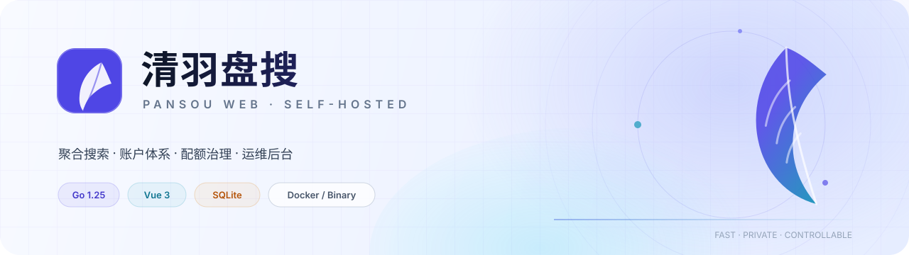
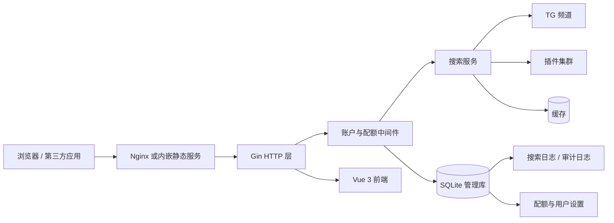

<div align="center">

**简体中文** · [English](README.en.md)

<picture>
  <source media="(prefers-color-scheme: dark)" srcset="docs/assets/banner-dark.svg">
  <source media="(prefers-color-scheme: light)" srcset="docs/assets/banner-light.svg">
  
</picture>

<h1>清羽盘搜</h1>

### 一个真正能自己运营的网盘搜索站

搜索聚合、账号体系、配额治理、IP 归属地、审计日志、上游自动同步与多平台发行，
全部收在同一个仓库里。Docker 一条命令上线，也可以下载单文件二进制直接运行。

[](https://github.com/willow-god/pansou-web/releases)
[](backend/go.mod)
[](frontend/package.json)
[](backend/admin/db.go)
[](https://github.com/willow-god/pansou-web/pkgs/container/pansou-web)
[](#发行版与单文件二进制)

</div>

---

## 目录

- [为什么是清羽盘搜](#为什么是清羽盘搜)
- [功能全景](#功能全景)
- [架构一览](#架构一览)
- [快速开始](#快速开始)
- [默认管理员与首次登录](#默认管理员与首次登录)
- [管理后台](#管理后台)
- [用户中心](#用户中心)
- [配额系统](#配额系统)
- [API 对接](#api-对接)
- [审计日志与搜索任务](#审计日志与搜索任务)
- [IP 归属地（GeoIP）](#ip-归属地geoip)
- [发行版与单文件二进制](#发行版与单文件二进制)
- [上游自动同步](#上游自动同步)
- [配置项](#配置项)
- [数据、备份与升级](#数据备份与升级)
- [本地开发与测试](#本地开发与测试)
- [目录结构](#目录结构)
- [常见问题](#常见问题)
- [安全说明](#安全说明)
- [致谢](#致谢)

## 为什么是清羽盘搜

PanSou 解决了“聚合搜索”本身：TG 频道、插件、网盘链接、缓存与并发调度。
但要把搜索结果开放给一群人使用，还缺一整套运营能力——谁在用、能用多少、超限怎么办、
出问题去哪里查、升级会不会丢数据。

清羽盘搜把这些补上：

- **统一账号**：用户名/邮箱密码、邮箱验证码注册、OAuth2 登录与绑定。
- **分层配额**：匿名按 IP、登录用户按网页/API 两条线，分别限制每日额度与每分钟频率。
- **可运营**：用户级额度覆盖、配额触发审计、搜索任务日志、IP 归属地、 CSV 导出。
- **可部署**：Docker 多架构镜像、单文件二进制、GitHub Release 一键出包。
- **可维护**：上游频道与插件默认值自动同步，运行参数后台化，升级只备份一个目录。

它不是把 PanSou 包一层壳，而是把“搜索能力”变成“可长期运营的服务”。

## 功能全景

| 模块 | 能力 |
| --- | --- |
| 聚合搜索 | TG 频道 + 插件并行搜索，结果合并、按网盘类型分组、链接有效性检测 |
| 搜索体验 | 关键词搜索、来源筛选、网盘类型筛选、刷新缓存、结果分类展示 |
| 账户体系 | 用户名/邮箱登录、邮箱验证码注册、密码修改、资料编辑、会话管理 |
| 第三方登录 | GitHub / Google / Linux DO / 通用 OIDC，支持登录与自动注册、账号绑定 |
| 个人 API | 最多 10 个 `ps_` 令牌，明文只展示一次；令牌共享账号额度，可随时吊销 |
| 匿名防护 | 同源网页凭证 + 单 IP 分钟限流 + 单 IP 日额度 + 全站匿名日额度 |
| 登录配额 | 网页搜索与 API 调用分开统计，每日额度 + 每分钟频率，支持用户级覆盖 |
| 超出提示 | 匿名用户引导登录，登录用户提示联系管理员；弹窗展示已用/上限与重置时间 |
| 管理后台 | 运营概览、用户管理、日志审计、认证与站点、OAuth、上游同步、运行参数、系统状态 |
| 可观测性 | 搜索关键词、来源、IP、UA、归属地、结果数、耗时、状态、错误逐条记录 |
| IP 归属地 | MaxMind MMDB，IPv4 必填 / IPv6 可选，私有地址自动跳过，保存后热加载 |
| 站点定制 | 站点名称、Slogan、描述、图标、Markdown 公告、浅色/深色主题 |
| 部署发行 | Docker amd64/arm64、Linux/macOS/Windows 二进制、GitHub Release、GHCR |
| 上游维护 | 构建时与运行时同步上游频道/插件默认值，支持热更新与失败回退 |

## 架构一览



**请求路径**

1. 浏览器打开页面，Nginx（Docker）或 Go 内嵌文件系统（单文件二进制）返回 Vue 应用。
2. 匿名网页搜索先向 `/api/web/token` 换取与 IP、UA 绑定的短期凭证。
3. 搜索请求进入 Gin，`AttachUser` 识别会话/API 令牌，`AccessGate` 依次校验：
   登录要求 → 网页搜索开关 → 同源凭证 → 分钟限频 → 每日额度。
4. 通过后写入一条 `pending` 搜索日志，再交给搜索服务并发抓取 TG 与插件。
5. 返回结果时补齐关键词、结果数、耗时与状态；超限则返回带详情与提示的 `429`。
6. 管理后台从同一 SQLite 读取统计、日志、配额与审计数据。

## 快速开始

### 方式一：Docker Compose（推荐）

```bash
curl -O https://raw.githubusercontent.com/willow-god/pansou-web/main/docker-compose.yml
docker compose up -d
```

打开 `http://localhost`。数据保存在 `pansou-data` 卷的 `/app/data`。

### 方式二：直接运行镜像

```bash
docker run -d --name pansou \
  -p 80:80 \
  -v pansou-data:/app/data \
  --restart unless-stopped \
  ghcr.io/willow-god/pansou-web:latest
```

镜像同时支持 `linux/amd64` 与 `linux/arm64`。所有持久化数据（账户库、缓存、日志、SSL、
GeoIP）都在 `/app/data`，升级镜像不会丢失。

### 方式三：下载单文件二进制

从 [Releases](https://github.com/willow-god/pansou-web/releases) 下载对应平台压缩包：

```bash
tar -xzf pansou-web_v1.0.0_linux_amd64.tar.gz
cd pansou-web_v1.0.0_linux_amd64
./pansou
```

Windows 解压后双击 `pansou.exe`。默认监听 `http://localhost:8888`，前端已嵌入二进制，
不需要 Node.js、Nginx 或额外静态文件。发行包内的 `upstream-defaults.env` 会被自动加载。

### 方式四：源码运行

要求 Node.js 22+、Go 1.25。

```bash
npm --prefix frontend ci

# 终端 1：后端 :8888
npm run dev:backend

# 终端 2：前端 :3000，自动代理 /api
npm run dev
```

打开 <http://localhost:3000>。

## 默认管理员与首次登录

首次启动会自动创建唯一管理员：

| 账号 | 密码 |
| --- | --- |
| `admin` | `admin123456` |

登录后会被强制要求修改密码；修改前只能访问用户中心、修改密码等必要接口。
管理员在数据库中全局唯一，接口不能新增、提升或删除管理员。

> [!WARNING]
> 公网部署前务必修改默认密码，并使用 HTTPS 反向代理。默认密码公开可见，
> 不修改等于把后台交给互联网。

**忘记管理员密码**：使用 `PANSOU_RESET_ADMIN=1` 启动一次后端/容器，会把管理员重置为
默认密码并强制改密。也可以删除数据卷中的 `pansou-admin.db` 重新初始化（会清空账户数据）。

## 管理后台

登录后点击右上角「控制台」进入。导航按运营流程组织：

| 页面 | 用途 |
| --- | --- |
| 运营概览 | 用户数、今日搜索、匿名搜索、配额触发、网页/API 分布、归属地 Top、匿名高频 IP、最近审计 |
| 用户管理 | 创建/禁用/删除用户，重置密码，设置角色与四项额度（网页/API 的每日与每分钟） |
| 日志与审计 | 搜索任务与审计日志双标签，按关键词/用户/IP/来源/状态/事件筛选，支持 CSV 导出 |
| 认证与站点 | 登录与注册开关、SMTP、API 权限、匿名/登录用户配额、GeoIP、站点名称/图标/公告 |
| OAuth2 登录 | 配置唯一启用的第三方登录入口与自动注册 |
| 上游自动同步 | 同步上游 TG 频道与插件列表，查看上次成功/失败、revision 与是否需要重启 |
| 运行参数 | 代理、缓存、并发、出口并发、网页搜索签名密钥 |
| 系统状态 | 插件、频道、TG 可达性、插件/频道存活观测 |

### 认证策略

| 功能 | 行为 |
| --- | --- |
| 用户名/邮箱密码登录 | 管理员始终允许密码登录，避免关闭普通登录后把自己锁死 |
| 邮箱注册 | 开启后强制 SMTP 验证码；未配置 SMTP 时无法保存该开关 |
| OAuth2 登录 | 已绑定第三方账号的用户可登录 |
| OAuth2 注册 | 第三方账号首次登录时自动创建本地用户 |
| 个人 API 令牌 | 用户中心最多 10 个；明文只显示一次，删除后立即失效 |
| 登录限流 | 同一 IP 或账号 15 分钟内失败 5 次即暂时锁定 |
| 会话 | 默认 7 天，可在后台调整；退出登录即失效，修改密码会让其他会话失效 |
| CSRF | Cookie 写请求校验 `Origin`；Bearer/API 令牌请求不受影响 |

OAuth2 回调地址统一为：

```text
https://你的域名/api/auth/oauth/callback
```

在服务商后台登记该地址，再填写 Client ID / Client Secret。内置 GitHub、Google、
Linux DO 与通用 OIDC 预设。

## 用户中心

普通用户登录后可以：

- 查看今日网页搜索与 API 调用用量、各自上限、每分钟频率、重置时间；
- 查看最近 20 条搜索任务（关键词、来源、结果数、耗时、状态）；
- 修改用户名、邮箱与密码；
- 管理个人 API 令牌（创建、命名、吊销，最多 10 个）；
- 绑定/解绑第三方账号。

配额卡片会明确标出「跟随全站默认」还是「管理员单独分配」，避免用户误以为额度丢失。

## 配额系统

配额按“身份 + 入口”拆分，互不混算：

| 身份 | 入口 | 每日额度 | 每分钟频率 | 说明 |
| --- | --- | --- | --- | --- |
| 匿名 | `/api/web/search` | 单 IP **20** 次 | 单 IP **4** 次 | 另有全站匿名每日 **200** 次 |
| 登录用户 | `/api/web/search` | **100** 次 | **10** 次 | 网页端搜索，计入网页额度 |
| 登录用户 | `/api/search` | **100** 次 | **10** 次 | 外部应用/脚本，计入 API 额度 |

以上均为默认值，可在「管理后台 → 认证与站点」修改。单个用户可在「用户管理」中覆盖：

- 网页每日额度、网页每分钟频率；
- API 每日额度、API 每分钟频率；
- 填 `0` 表示跟随全站默认，不填不会“锁死”用户。

### 统计口径

- **网页搜索**：浏览器页面发起的搜索，统一走 `/api/web/search`。
- **API 调用**：外部应用携带个人令牌调用 `/api/search`。
- 两个入口分别计数，刷新页面、切换筛选不会重置额度。
- 每日额度在服务器本地时区 **00:00** 重置（Docker 镜像默认 `Asia/Shanghai`）。
- 只有真正的搜索消耗额度；插件 Web 页面、链接检测不计入搜索次数。
- 匿名限制先校验分钟频率，再校验单 IP 日额度，最后校验全站日额度。

### 超限响应

所有配额错误返回 `429`，并附带结构化字段，前端据此弹出对应提示：

```json
{
  "error": "当前 IP 今日匿名搜索次数已达上限（20 次），登录后可享受更高额度",
  "code": "ANON_IP_DAILY_LIMIT",
  "scope": "anonymous_ip_daily",
  "limit": 20,
  "used": 20,
  "retry_after": 0,
  "login_recommended": true,
  "contact_admin": false
}
```

| `code` | 含义 | 前端提示 |
| --- | --- | --- |
| `ANON_RATE_LIMITED` | 匿名每分钟过快 | 稍后再试 / 登录 |
| `ANON_IP_DAILY_LIMIT` | 单 IP 匿名日额度用完 | 登录享受更高额度 |
| `ANON_GLOBAL_DAILY_LIMIT` | 全站匿名日额度用完 | 登录继续搜索 |
| `WEB_RATE_LIMITED` | 登录用户网页搜索过快 | 等待后重试 |
| `WEB_DAILY_LIMIT_REACHED` | 登录用户网页日额度用完 | 联系管理员提高额度 |
| `API_RATE_LIMITED` | API 调用过快 | 降低请求频率 |
| `API_DAILY_LIMIT_REACHED` | API 日额度用完 | 联系管理员提高额度 |

匿名用户看到「登录 / 注册，享受更高额度」；登录用户看到「联系管理员提高配额」。
弹窗同时展示当前用量、上限与重置时间。所有超限事件都会写入审计日志。

### 防绕过设计

网页匿名搜索不是公开 API：

1. 页面先向 `/api/web/token` 换取短期凭证；
2. 凭证与请求 IP、User-Agent 绑定，并通过 HMAC 签名；
3. 搜索时必须携带 `X-Web-Token`，且请求来源必须同源；
4. 后端同时执行匿名分钟限流、单 IP 日额度与全站日额度。

因此不能简单把 `/api/web/search` 复制到脚本里当免费接口使用。第三方应用应使用
`/api/search` + 个人 API 令牌。

## API 对接

### 创建令牌

登录后进入「用户中心 → API 令牌」，创建并复制 `ps_...` 明文（只显示一次）。

```bash
curl -H "Authorization: Bearer ps_xxxxxxxx" \
     "http://localhost/api/search?kw=仙逆"
```

也可以使用 `X-API-Token` 请求头。所有令牌共享该账号的 API 额度，删除后立即失效。

### 接口

| 方法 | 路径 | 用途 |
| --- | --- | --- |
| GET/POST | `/api/search` | 外部 API 搜索，消耗 API 配额 |
| GET/POST | `/api/web/search` | 网页搜索，消耗网页配额，匿名需网页凭证 |
| POST | `/api/check/links` | 链接有效性检测 |
| GET | `/api/health` | 健康检查、插件/频道/TG 状态 |
| GET | `/api/auth/me` | 当前用户、配额与认证开关 |
| GET | `/api/auth/usage` | 今日用量、额度、频率、最近搜索 |

### 搜索参数

GET 查询参数与 POST JSON 字段一致：

| 参数 | 说明 |
| --- | --- |
| `kw` | 关键词，必填 |
| `channels` | 指定 TG 频道，逗号分隔 |
| `conc` | 并发数 |
| `refresh` | 是否刷新缓存 |
| `res` | `all` / `results` / `merge` |
| `src` | `all` / `tg` / `plugin` |
| `plugins` | 指定插件，逗号分隔 |
| `cloud_types` | 指定网盘类型 |
| `ext` | 扩展 JSON |
| `filter` | 结果过滤配置 |

成功响应保持上游 PanSou 结构：

```json
{
  "code": 0,
  "message": "success",
  "data": {
    "total": 42,
    "results": [],
    "merged_by_type": {}
  }
}
```

### 状态码

| 状态码 | 场景 |
| --- | --- |
| `401 UNAUTHORIZED` | 未登录 / 令牌无效 / 开启 API 必须登录 |
| `403 WEB_SEARCH_DISABLED` | 管理员关闭了匿名网页搜索 |
| `403 WEB_TOKEN_REQUIRED` | 匿名网页凭证缺失、过期或来源不符 |
| `403 MUST_CHANGE_PASSWORD` | 默认管理员未修改密码 |
| `429` + `code` | 触发分钟限频或每日额度 |

> `/api/search` 默认要求登录。管理员可在后台关闭「API 必须登录」，但不建议公网这样做。

## 审计日志与搜索任务

管理后台「日志与审计」分为两个标签页，均支持筛选、分页与 CSV 导出。

### 搜索任务

每条实际搜索记录：

- 时间、用户、来源（网页/API）、关键词；
- IP、国家、省/州、城市；
- 结果数、耗时、状态（`pending` / `ok` / `error` / `bad_request`）；
- 错误信息（如有）、User-Agent。

搜索开始先写入 `pending`，完成后补齐结果；便于排查“请求进来了但没返回”的问题。

### 审计事件

记录登录、注册、配额触发与后台操作：

`login_success`、`login_failed`、`login_throttled`、`logout`、`register`、
`password_change`、`profile_update`、`quota_exceeded`、`settings_update`、
`runtime_update`、`user_create`、`user_update`、`user_delete`、`upstream_sync`、
`api_token_create`、`api_token_delete`。

审计条目包含操作者、对象、详情、IP、归属地与 UA。日志默认保留 **180 天**，
启动时自动清理更早数据，避免 SQLite 长期膨胀。

## IP 归属地（GeoIP）

归属地是可选能力，默认关闭。关闭时日志仍记录 IP，只是国家/地区/城市为空。

### 1. 准备数据库

从 [MaxMind GeoLite2](https://dev.maxmind.com/geoip/geolite2-free-geolocation-data)
下载 `GeoLite2-City.mmdb`。请遵守 MaxMind 的许可与署名要求。

### 2. 挂载进容器

编辑 `docker-compose.yml`，取消注释：

```yaml
volumes:
  - pansou-data:/app/data
  - ./geoip:/app/data/geoip:ro
```

把文件放到宿主机 `./geoip/GeoLite2-City.mmdb`，然后 `docker compose up -d`。

### 3. 后台开启

进入「管理后台 → 认证与站点 → IP 归属地」：

1. 打开「启用 IP 归属地」；
2. IPv4 数据库路径填 `/app/data/geoip/GeoLite2-City.mmdb`（**开启后必填**）；
3. IPv6 数据库可选；留空时复用 IPv4 数据库；
4. 保存。

保存时后端会校验文件存在且能被 MMDB 读取，失败会拒绝保存；成功后立即热加载，
无需重启。回环地址、私有地址与非法 IP 自动跳过。单文件二进制部署时填写本机绝对路径即可。

## 发行版与单文件二进制

`.github/workflows/build-docker.yml` 负责镜像与发行包：

### 版本号显示在运行标题

手动触发时填写 `image_tag`（如 `v1.4.0`），Actions 运行标题会显示：

```text
发布 v1.4.0
```

一眼就能判断这次发布的是什么版本、下一个该发什么版本。通过 GitHub Release
触发时，标题自动使用 Release 的 tag。

### latest 标签开关

手动触发时 `publish_latest` 默认勾选：

- 勾选：同时推送 `:v1.4.0` 与 `:latest`；
- 取消：只推送 `:v1.4.0`，适合预发布或灰度版本。

通过 GitHub Release 发布时默认同步更新 `latest`。

### Release 与多平台二进制

工作流会：

1. 构建前端并打包进 Go 二进制（`release_frontend` 构建标签 + `go:embed`）；
2. 交叉编译 Linux amd64/arm64、macOS amd64/arm64、Windows amd64；
3. 生成 `tar.gz` / `zip`，内含可执行文件、`upstream-defaults.env`、`START_HERE.txt`；
4. 创建或更新 GitHub Release，附件自动上传；
5. Release 说明由提交信息自动生成（`--generate-notes`）。

发行包命名：

```text
pansou-web_v1.4.0_linux_amd64.tar.gz
pansou-web_v1.4.0_linux_arm64.tar.gz
pansou-web_v1.4.0_darwin_amd64.tar.gz
pansou-web_v1.4.0_darwin_arm64.tar.gz
pansou-web_v1.4.0_windows_amd64.zip
```

解压即用，不需要安装运行时。默认数据目录：

- 账户库：`./data/pansou-admin.db`（可用 `ADMIN_DB_PATH` 覆盖）
- 缓存：`./cache`（可用 `CACHE_PATH` 覆盖）
- 端口：`8888`（可用 `PORT` 覆盖）

`upstream-defaults.env` 会从当前目录或可执行文件目录自动加载；显式设置
`CHANNELS` / `ENABLED_PLUGINS` 时以环境变量为准。

## 上游自动同步

TG 频道与插件列表不写死在代码里，有三层保障：

1. **构建时**：`scripts/sync-upstream-defaults.mjs` 读取上游 Dockerfile 的
   `CHANNELS` / `ENABLED_PLUGINS`，生成 `deploy/upstream-defaults.env` 并打包；
   抓取失败时使用仓库内快照，不中断构建。
2. **运行时**：后台默认每 24 小时同步一次；GitHub raw 不可达时回退 jsDelivr；
   频道与插件列表热更新，无需重启；启用列表同时写入 `/app/data/upstream-defaults.env`。
3. **代码同步**：`scripts/sync-backend.sh` 通过 git subtree 拉取上游后端；
   GitHub Actions 每周自动创建 PR。

运行期同步只更新配置数据，不执行上游代码；插件代码更新仍需重新构建镜像。

## 配置项

代理、缓存、并发、网页搜索签名与上游同步地址都可在管理后台维护。环境变量只在首次启动
或后台没有记录时作为默认值。

| 变量 | 默认值 | 说明 |
| --- | --- | --- |
| `PORT` | `8888` | 后端监听端口（容器内） |
| `ADMIN_DB_PATH` | `data/pansou-admin.db` | 管理库路径；镜像内为 `/app/data/pansou-admin.db` |
| `DATA_DIR` | `data` | 未设置 `ADMIN_DB_PATH` 时的数据目录 |
| `CACHE_PATH` | `./cache` | 搜索缓存目录；镜像内为 `/app/data/cache` |
| `CACHE_ENABLED` / `CACHE_TTL` | `true` / `60` | 后台未保存时的缓存默认值 |
| `CHANNELS` | 上游快照 | 显式覆盖 TG 频道；设置后阻止重启加载自动同步结果 |
| `ENABLED_PLUGINS` | 上游快照 | 显式覆盖启用插件，同上 |
| `PROXY` / `NO_PROXY` | 无 | 后台未保存代理时的默认值 |
| `CONCURRENCY` | 自动 | 后台未保存并发时的默认值 |
| `OUTBOUND_MAX_CONCURRENCY` | `128` | 出站并发上限 |
| `WEB_TOKEN_SECRET` | 随机生成 | 网页凭证签名密钥；多副本部署应统一 |
| `PANSOU_RESET_ADMIN` | 无 | 设为 `1` 启动一次可重置管理员密码 |

### 运行参数生效方式

| 参数 | 生效方式 |
| --- | --- |
| 出站代理 | 重启容器 |
| 缓存开关 | 重启容器 |
| 缓存 TTL | 立即生效（影响新写入） |
| 默认搜索并发 | 立即生效；`0` 表示自动计算 |
| 出口并发上限 | 重启容器 |
| 网页搜索签名密钥 | 立即生效，现有网页凭证失效 |
| 上游 Dockerfile 地址 / 输出路径 | 下次同步时生效 |

## 数据、备份与升级

Docker 部署备份一个卷即可：

```bash
docker run --rm -v pansou-data:/data -v "$PWD":/backup \
  alpine tar -czf /backup/pansou-backup.tar.gz -C /data .
```

重点内容：

- `pansou-admin.db`：用户、会话、设置、OAuth、SMTP、配额、搜索日志、审计日志；
- `upstream-defaults.env`：运行期同步的上游默认值；
- `cache/`、`logs/`、`ssl/`、`geoip/`。

升级：

```bash
docker compose pull
docker compose up -d
```

数据库迁移在启动时自动执行（SQLite WAL + `ensureColumn`），升级不会清空账户。

## 本地开发与测试

```bash
# 一键校验：同步默认值 + 前端构建 + 后端测试/编译
bash scripts/check.sh

# 仅后端测试
cd backend && go test ./admin/... ./config/... ./api/... ./service/... ./util/json/...

# 仅前端生产构建
npm --prefix frontend run build
```

要求 Go 1.25、Node.js 22。后端默认 `:8888`，Vite 默认 `:3000` 并代理 `/api`。
本地账户库位于 `data/pansou-admin.db`，删除即可重置。

## 目录结构

```text
.
├── backend/
│   ├── admin/                 # 账户、会话、OAuth、SMTP、配额、GeoIP、审计、上游同步
│   ├── api/                   # 搜索/检测路由、访问控制、内嵌前端静态服务
│   ├── webui/                 # release_frontend 构建时嵌入前端 dist
│   ├── standalone_defaults.go # 单文件二进制加载 upstream-defaults.env
│   ├── config/ service/ plugin/ util/
│   └── UPSTREAM.md
├── frontend/
│   └── src/
│       ├── components/        # 搜索、结果、账户、控制台、配额弹窗
│       ├── components/admin/  # 运营概览、用户、日志、设置、OAuth、运行参数
│       ├── stores/auth.ts
│       └── api/auth.ts
├── deploy/upstream-defaults.env
├── docs/assets/               # 文档横幅（深色/浅色）
├── scripts/                   # 上游同步、开发启动、一键检查
├── .github/workflows/         # CI、镜像/Release、上游同步
├── Dockerfile
├── docker-compose.yml
└── start.sh
```

## 常见问题

<details>
<summary><strong>登录后一直提示修改密码？</strong></summary>

默认管理员首次登录必须修改密码；修改前只能访问用户中心与修改密码接口。
如果忘记密码，用 `PANSOU_RESET_ADMIN=1` 启动一次，或删除 `pansou-admin.db` 重新初始化。
</details>

<details>
<summary><strong>匿名搜索提示“凭证无效”？</strong></summary>

页面会先请求 `/api/web/token`。如果使用了反向代理，请确保保留 `Origin`、`Host`
与真实客户端 IP 头（`X-Forwarded-For` / `X-Real-IP`），并让 `X-Forwarded-Proto`
与实际协议一致。凭证与 IP、UA 绑定，刷新页面会重新获取。
</details>

<details>
<summary><strong>为什么登录用户网页搜索和 API 额度分开了？</strong></summary>

网页搜索走 `/api/web/search`，第三方应用走 `/api/search`。两者使用不同配额，
避免网页端使用挤占机器人/脚本的 API 额度，也方便管理员分别调整。
</details>

<details>
<summary><strong>GeoIP 保存失败？</strong></summary>

开启后 IPv4 路径必填，且文件必须存在、可读、是有效的 MMDB。容器内路径要先通过
volume 挂载进去。IPv6 可选；留空时复用 IPv4 数据库。
</details>

<details>
<summary><strong>上游同步失败会不会影响搜索？</strong></summary>

不会。同步失败会保留上一次成功的列表或仓库快照；后台会显示失败原因与上次成功时间。
运行期同步只更新配置数据，不执行上游代码。
</details>

<details>
<summary><strong>单文件二进制为什么没有前端页面？</strong></summary>

请确认下载的是 Release 中的发行包，而不是自行执行普通 `go build`。
发行包使用 `release_frontend` 标签构建，前端已通过 `go:embed` 嵌入；
普通构建需要由 Nginx 提供 `frontend/dist`。
</details>

## 安全说明

- 默认管理员密码公开可见，**首次登录必须修改**；公网部署请使用 HTTPS。
- `/api/search` 默认要求登录；个人令牌只存哈希，明文仅创建时展示一次。
- 匿名网页搜索凭证与 IP、UA 绑定，并校验同源，降低被脚本直接盗用的风险。
- 管理接口统一经过 `RequireAuth` + `RequireAdmin`；普通用户无法越权。
- 数据库层保证管理员唯一，不能通过接口创建第二个管理员或提升权限。
- 登录失败按 IP 与账号双维度限流；Cookie 写请求校验 `Origin`。
- 审计日志可能包含 IP、UA 与归属地，请按当地隐私法规设置保留期与访问权限。
- 本项目不含任何资源存储或分发能力，仅聚合公开搜索结果；请遵守所在地法律与上游服务条款。

## 致谢

- 后端与插件生态：[fish2018/pansou](https://github.com/fish2018/pansou)
- 原前端项目：[fish2018/pansou-web](https://github.com/fish2018/pansou-web)
- IP 归属地数据库：[MaxMind GeoLite2](https://dev.maxmind.com/geoip/geolite2-free-geolocation-data)

本项目是在上游基础上的自维护改造版。上游代码、插件与数据的版权归原作者所有，
使用与再分发前请遵守对应项目的许可与服务条款。

<div align="center">

**[⬆ 回到顶部](#清羽盘搜)** · [English Documentation](README.en.md)

</div>
